# Phần B: Model-Driven DSS với Excel

## 1. Tổng quan Phần B

Phần B xây dựng bốn mô hình ra quyết định trong Excel trên cùng dữ liệu DataCo đã làm sạch ở Phần A (62.897 đơn, 172.765 dòng đơn). Mỗi bài toán có đủ bốn thành phần: biến quyết định, biến kết quả, công thức, ràng buộc. Bốn bài toán dùng đủ bốn công cụ mà đề yêu cầu.

| Bài toán | Câu hỏi quản lý | Công cụ Excel |
|---|---|---|
| 1. Cơ cấu phương thức vận chuyển | Dịch chuyển tỷ trọng đơn giữa 4 phương thức thế nào để lợi nhuận cao nhất mà tỷ lệ trễ vẫn đạt ngưỡng | Solver (Simplex LP) |
| 2. Chính sách chiết khấu | Đổi mức chiết khấu thì lợi nhuận đổi bao nhiêu, cầu nhạy đến mức nào thì giảm giá mới đáng | Data Table (1 và 2 biến), Scenario Manager, Goal Seek |
| 3. Điểm hoà vốn theo ngành hàng | Ngành nào đang bán sát điểm hoà vốn, dễ lỗ khi sản lượng giảm | Goal Seek, Data Table |
| 4. Phân bổ đơn giữa 5 thị trường | Với cùng tổng số đơn, nên dồn nguồn lực về thị trường nào | Solver (Simplex LP) |

Quy ước màu trong file Excel: ô nền vàng là biến quyết định hoặc biến mục tiêu; ô nền xanh nhạt là tham số do người ra quyết định đặt hoặc tiêu đề cột.

### 1.1. Tham số do người ra quyết định đặt

Mô hình ra quyết định cần hai loại đầu vào. Loại thứ nhất là hệ số lấy từ dữ liệu: lợi nhuận mỗi đơn, tỷ lệ trễ, giá, biến phí. Loại thứ hai là giới hạn và mục tiêu do người ra quyết định đặt, giống các ràng buộc "ngân sách không quá 100 triệu" hay "không quá 160 giờ mỗi tháng" trong đề bài. Dữ liệu DataCo không chứa chi phí cố định, năng lực kho hay độ co giãn của cầu, nên các tham số dưới đây do nhóm đặt. Mỗi tham số nằm ở một ô riêng (nền xanh nhạt) và có phân tích độ nhạy đi kèm để kết luận không phụ thuộc vào một con số duy nhất.

| Mã | Tham số | Giá trị | Lý do chọn | Điều kiện xem lại |
|---|---|---|---|---|
| G1 | Chi phí phạt mỗi đơn trễ | 0 USD (nhập số dương để thử, ví dụ 20) | Mặc định 0 để mô hình chỉ dùng lợi nhuận lấy từ dữ liệu; giá trị dương dùng để thử độ nhạy | Có số chi phí chăm sóc khách hàng thật |
| G2 | Ngưỡng tỷ lệ trễ chung | 45% | Mục tiêu quản trị do ban điều hành đặt, thấp hơn mức hiện tại 57,3%; ngưỡng 40% không có nghiệm trong biên dịch chuyển ±15 điểm % | Ban điều hành đặt cam kết giao hàng khác |
| G3 | Biên dịch chuyển tỷ trọng mỗi phương thức | ±15 điểm % | Khách chọn phương thức theo nhu cầu nên không thể ép dịch chuyển hoàn toàn | Có dữ liệu khách đổi phương thức |
| G4 | η: % sản lượng tăng cho mỗi +1 điểm % chiết khấu | 0% làm cơ sở, thử đến 3% | Dữ liệu cho η bằng 0 (tương quan chiết khấu và số lượng là −0,001, gần như bằng 0) nên mọi η dương là giả định để thử độ nhạy | Có thí nghiệm giảm giá thật (A/B test) |
| G5 | Chi phí cố định chia doanh thu thuần của ngành | 7% | Thấp hơn biên lợi nhuận chung 12,0% nên ngành trung bình vẫn có lãi | Có báo cáo chi phí cố định theo ngành |
| G6 | Biên nhu cầu mỗi thị trường | ±20% | Giới hạn năng lực và nhu cầu trong một kỳ kế hoạch | Có số năng lực kho theo thị trường |

Hai điều kiện áp dụng cho cả bốn bài toán:

- Số liệu tính sau khi loại đơn huỷ (CANCELED) và đơn nghi gian lận (SUSPECTED_FRAUD) ở bước ETL của Phần A, nên khớp với số liệu Phần A (62.897 đơn).
- Dữ liệu giao hàng có dạng mô phỏng: số ngày giao thực tế gần như cố định theo từng phương thức. Vì vậy kết luận về phương thức vận chuyển chỉ đúng trong dữ liệu này.

## 2. Bài toán 1: Cơ cấu phương thức vận chuyển

### 2.1. Mô tả

Tỷ lệ giao trễ hiện là 57,3%. Ban điều hành muốn đưa tỷ lệ này về không quá 45%. Câu hỏi là nên dịch chuyển tỷ trọng đơn giữa bốn phương thức thế nào để lợi nhuận cao nhất mà vẫn đạt ngưỡng, và việc đạt ngưỡng tốn bao nhiêu lợi nhuận.

### 2.2. Mô hình

| Thành phần | Nội dung |
|---|---|
| Biến quyết định | Tỷ trọng đơn của First Class, Same Day, Second Class, Standard Class (ô B4:E4) |
| Biến kết quả | Tổng lợi nhuận (ô B20), cần tối đa |
| Công thức | Lợi nhuận mỗi đơn của phương thức i trừ chi phí phạt (ô B15, mặc định 0) nhân tỷ lệ trễ của i. Tổng lợi nhuận = N × SUMPRODUCT(tỷ trọng, lợi nhuận mỗi đơn), với N = 62.897 |
| Ràng buộc | Tổng tỷ trọng bằng 100%. Tỷ lệ trễ chung (SUMPRODUCT của tỷ trọng và tỷ lệ trễ) không quá 45%. Mỗi tỷ trọng nằm trong khoảng từ tỷ trọng hiện tại trừ 15 điểm % đến cộng 15 điểm %, và không âm |

Dữ liệu đầu vào lấy từ sheet DuLieu:

| Phương thức | Số đơn | Tỷ trọng hiện tại | Lợi nhuận mỗi đơn (USD) | Tỷ lệ trễ |
|---|---|---|---|---|
| First Class | 9.602 | 15,27% | 64,22 | 100,0% |
| Same Day | 3.407 | 5,42% | 57,00 | 48,4% |
| Second Class | 12.256 | 19,49% | 58,98 | 80,0% |
| Standard Class | 37.632 | 59,83% | 60,39 | 39,8% |

### 2.3. Các bước thực hiện trong Excel

1. Mở sheet BT1_Solver. Các ô B4:E4 là biến quyết định, đang chứa tỷ trọng hiện tại. Ô B15 (chi phí phạt) để 0.
2. Kiểm tra các công thức đã lập: B20 là tổng lợi nhuận, B21 là tỷ lệ trễ chung, B22 là tổng tỷ trọng.
3. Chọn Data, rồi Solver. Nếu không thấy nút Solver, vào File, Options, Add-ins, Manage Excel Add-ins, Go, tick Solver Add-in.
4. Điền hộp thoại Solver:
   - Set Objective: B20, chọn Max.
   - By Changing Variable Cells: B4:E4.
   - Bấm Add, thêm bốn ràng buộc theo bảng A28:D32: B4:E4 lớn hơn hoặc bằng B6:E6; B4:E4 nhỏ hơn hoặc bằng B7:E7; B22 bằng 1; B21 nhỏ hơn hoặc bằng B16.
   - Tick Make Unconstrained Variables Non-Negative.
   - Select a Solving Method: Simplex LP.
5. Bấm Solve, chọn Keep Solver Solution, rồi OK.
6. Đối chiếu kết quả với bảng ở A34:E38 trong cùng sheet; hai bên trùng nhau.
7. Chạy lại lần hai với B15 bằng 20 (đưa B4:E4 về tỷ trọng hiện tại trước khi chạy) để xem độ nhạy theo chi phí phạt, rồi đối chiếu với bảng ở A40:E44. Sau đó đặt B15 về 0 và đưa B4:E4 về tỷ trọng hiện tại.
8. Chụp màn hình bảng kết quả và hộp thoại Solver để đưa vào báo cáo.

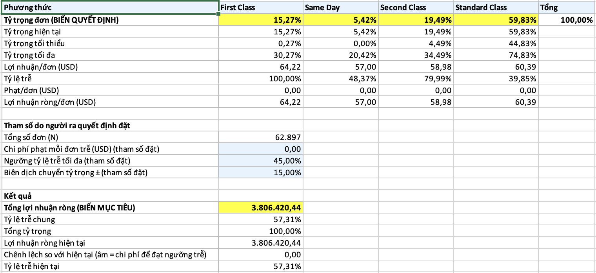

*Hình 1: Bài toán 1: bảng mô hình trước khi chạy Solver (tỷ trọng hiện tại).*

*Hình 2: Bài toán 1: hộp thoại Solver Parameters.*

### 2.4. Kết quả

Kết quả chính (chi phí phạt bằng 0):

| Chỉ tiêu | Hiện tại | Tối ưu |
|---|---|---|
| Tỷ trọng First Class | 15,27% | 3,08% |
| Tỷ trọng Same Day | 5,42% | 17,60% |
| Tỷ trọng Second Class | 19,49% | 4,49% |
| Tỷ trọng Standard Class | 59,83% | 74,83% |
| Tỷ lệ trễ chung | 57,31% | 45,00% |
| Lợi nhuận (USD) | 3.806.420 | 3.764.422 |

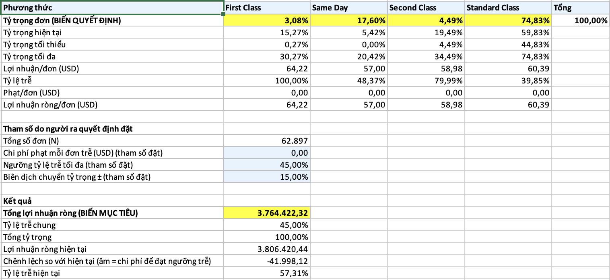

*Hình 3: Bài toán 1: kết quả sau khi chạy Solver.*

Đưa tỷ lệ trễ về đúng ngưỡng 45% làm lợi nhuận giảm 41.998 USD, tương đương 1,10%. Ràng buộc trễ bị chạm: tỷ lệ trễ tối ưu bằng đúng ngưỡng. Ngưỡng 40% không có nghiệm trong biên dịch chuyển ±15 điểm %.

Độ nhạy theo chi phí phạt đơn trễ:

| Chi phí phạt mỗi đơn trễ | Tỷ lệ trễ tối ưu | Ràng buộc 45% | Thay đổi lợi nhuận (đã trừ phạt) so với hiện tại |
|---|---|---|---|
| 0 USD | 45,00% | Chạm | giảm 41.998 USD (chi phí của việc đạt ngưỡng) |
| 20 USD | 43,55% | Không chạm | tăng 118.384 USD (3,8%) |

Khi mỗi đơn trễ có chi phí 20 USD, giảm trễ tự nó mang lại lợi nhuận, nên tỷ trọng tối ưu chuyển hẳn sang Standard Class và Same Day (0,27%, 20,42%, 4,49%, 74,83% theo thứ tự bốn phương thức) và ràng buộc 45% không còn cần thiết, vì tỷ lệ trễ tối ưu chỉ còn 43,55%, là mức thấp nhất đạt được trong biên dịch chuyển ±15 điểm %.

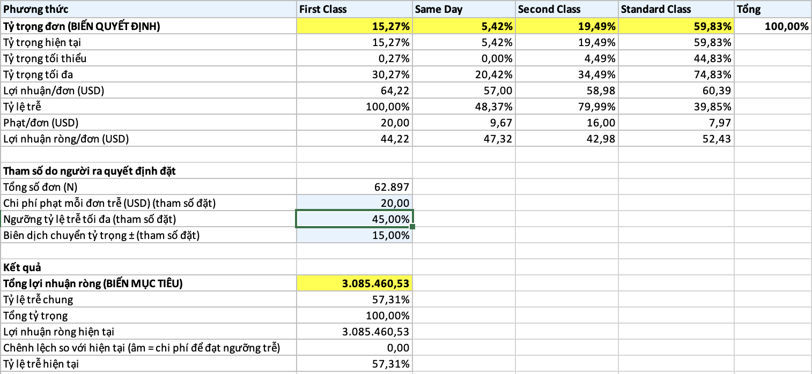

*Hình 4: Bài toán 1: chi phí phạt 20 USD, trước khi chạy Solver.*

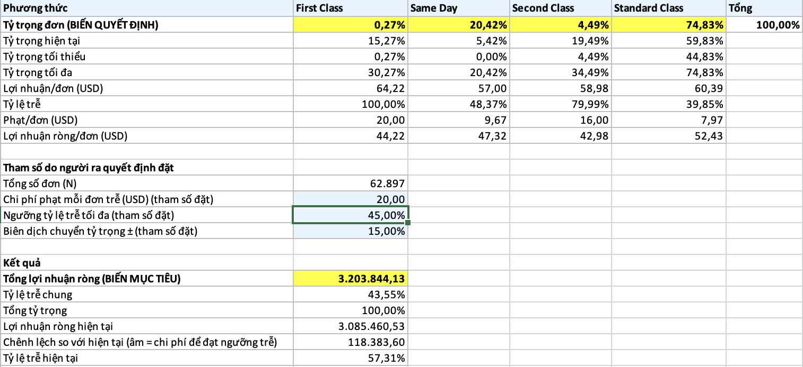

*Hình 5: Bài toán 1: chi phí phạt 20 USD, sau khi chạy Solver.*

### 2.5. Ý nghĩa quản lý

- Nên khuyến khích khách chuyển từ First Class và Second Class sang Standard Class và Same Day. Hai phương thức nhanh và đắt hiện trễ nhiều nhất (100% và 80,0%) mà không mang thêm lợi nhuận.
- Chỉ cần dịch chuyển đủ để đạt ngưỡng 45% là mất 41.998 USD lợi nhuận (1,1%), một chi phí nhỏ so với việc giảm hơn 12 điểm % tỷ lệ trễ. Nếu mỗi đơn trễ gây tổn thất từ 20 USD trở lên thì việc giảm trễ có lãi.
- Hạn chế: lợi nhuận mỗi đơn và tỷ lệ trễ của từng phương thức được giữ nguyên khi tỷ trọng đổi; chi phí phạt là tham số thử; và tỷ lệ trễ trong dữ liệu có dạng mô phỏng nên mức cải thiện thực tế có thể khác.

## 3. Bài toán 2: Chính sách chiết khấu

### 3.1. Mô tả

Chiết khấu trung bình hiện là 10,16%. Trong dữ liệu, chiết khấu không làm tăng số lượng mua (số lượng trung bình mỗi dòng luôn khoảng 2,13 ở mọi mức giảm giá) nhưng làm giảm lợi nhuận mỗi dòng, từ 26,42 USD khi không giảm giá xuống 18,88 USD ở dải 20% đến 25%. Câu hỏi là đổi mức chiết khấu thì lợi nhuận đổi bao nhiêu, và cầu phải nhạy đến mức nào thì tăng chiết khấu mới không làm giảm lợi nhuận.

### 3.2. Mô hình

| Thành phần | Nội dung |
|---|---|
| Biến quyết định | Mức chiết khấu mới d (ô B8); độ nhạy của cầu η (ô B9, là giả định) |
| Biến kết quả | Tổng lợi nhuận (ô B15) và chênh lệch so với hiện tại (ô B17) |
| Công thức | Lợi nhuận mỗi dòng = a + b × d, với a và b là kết quả hàm INTERCEPT và SLOPE trên 6 dải chiết khấu (a = 25,28 USD; b = −29,98 USD cho mỗi +100% chiết khấu). Số dòng đơn mới = N0 × (1 + η × (d − d0) × 100), với N0 = 172.765 và d0 = 10,16%. Tổng lợi nhuận = số dòng đơn mới × lợi nhuận mỗi dòng |
| Ràng buộc | 0% ≤ d ≤ 25%, là khoảng chiết khấu có trong dữ liệu |

Lợi nhuận hiện tại theo mô hình (d bằng d0, η bằng 0) là khoảng 3.841.716 USD.

### 3.3. Các bước thực hiện trong Excel

**a) Data Table một biến: lợi nhuận theo mức chiết khấu**

1. Mở sheet BT2_WhatIf, phần a (hàng 20 đến 27). Hàng 21 đã chứa công thức đầu ra, cột A22:A27 là các mức chiết khấu 0%, 5%, 10%, 15%, 20%, 25%.
2. Chọn vùng A21:C27.
3. Chọn Data, What-If Analysis, Data Table. Để trống Row input cell, nhập Column input cell là B8, bấm OK.
4. Kiểm tra ô B22 hiển thị công thức dạng bảng dữ liệu. Nếu Excel để trống các ô kết quả, bấm F9 để tính lại.

*Hình 6: Bài toán 2: hộp thoại Data Table một biến (Column input cell là B8).*

**b) Data Table hai biến: chiết khấu và độ nhạy của cầu**

1. Ở phần b (hàng 30 đến 37), góc trên trái A31 chứa công thức đầu ra, hàng 31 là các giá trị η, cột A32:A37 là các mức chiết khấu.
2. Chọn vùng A31:F37.
3. Chọn Data, What-If Analysis, Data Table. Row input cell là B9, Column input cell là B8, bấm OK.

*Hình 7: Bài toán 2: hộp thoại Data Table hai biến (Row input cell là B9, Column input cell là B8).*

**c) Scenario Manager**

1. Chọn Data, What-If Analysis, Scenario Manager. Danh sách đã có sẵn 5 kịch bản; nếu không thấy, bấm Add và nhập theo bảng A41:C46 với Changing cells là B8:B9.
2. Bấm Summary, chọn Scenario summary, Result cells là B15 và B17, bấm OK.
3. Dùng bảng công thức ở A41:F46 để đối chiếu với báo cáo tóm tắt của Excel.

*Hình 8: Bài toán 2: danh sách 5 kịch bản trong Scenario Manager.*

*Hình 9: Bài toán 2: hộp thoại sửa một kịch bản.*

**d) Goal Seek: η tối thiểu để chiết khấu 15% không làm giảm lợi nhuận**

1. Ở phần d (hàng 49 đến 53), B50 là mức chiết khấu cần xét (15%), B51 là ô sẽ thay đổi, B52 là chênh lệch lợi nhuận cần đưa về 0.
2. Chọn Data, What-If Analysis, Goal Seek. Set cell: B52. To value: 0. By changing cell: B51. Bấm OK.
3. So sánh B51 với đáp án giải tích ở B53; hai số phải trùng nhau.

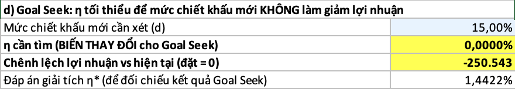

*Hình 10: Bài toán 2: Goal Seek, trạng thái trước khi chạy.*

*Hình 11: Bài toán 2: hộp thoại Goal Seek.*

### 3.4. Kết quả

Lợi nhuận theo mức chiết khấu khi η bằng 0:

| Chiết khấu | Lợi nhuận (USD) | Chênh lệch so với hiện tại (USD) |
|---|---|---|
| 0% | 4.368.050 | +526.334 |
| 5% | 4.109.091 | +267.375 |
| 10% | 3.850.132 | +8.416 |
| 15% | 3.591.173 | −250.543 |
| 20% | 3.332.214 | −509.502 |
| 25% | 3.073.255 | −768.461 |

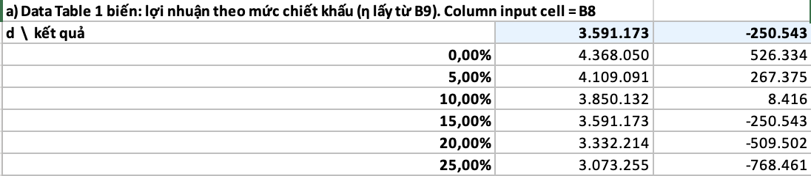

*Hình 12: Bài toán 2: kết quả Data Table một biến.*

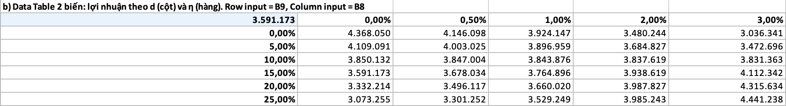

*Hình 13: Bài toán 2: kết quả Data Table hai biến.*

Năm kịch bản:

| Kịch bản | d | η | Lợi nhuận (USD) | Chênh lệch (USD) |
|---|---|---|---|---|
| KB1 Ngừng giảm giá | 0% | 0% | 4.368.050 | +526.334 |
| KB2 Giảm giá thấp | 5% | 0% | 4.109.091 | +267.375 |
| KB3 Giữ hiện tại | 10,16% | 0% | 3.841.716 | 0 |
| KB4 Giảm giá cao, cầu nhạy | 20% | 2% | 3.987.827 | +146.111 |
| KB5 Giảm giá cao, cầu rất nhạy | 25% | 3% | 4.441.238 | +599.522 |

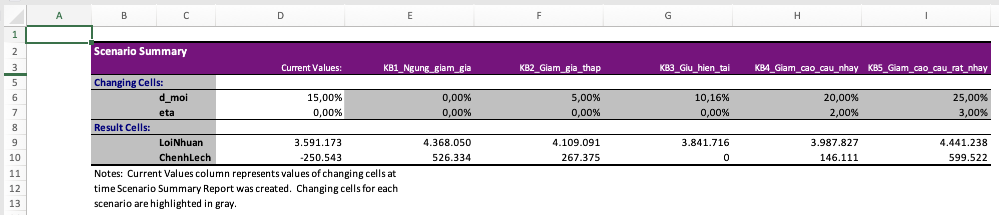

*Hình 14: Bài toán 2: báo cáo Scenario Summary. Cột Current Values ghi giá trị ô d (15%) tại thời điểm tạo báo cáo, không phải mức chiết khấu hiện tại 10,16% (kịch bản KB3).*

Kết quả Goal Seek: với d bằng 15%, η tối thiểu là 1,442% (cứ tăng thêm 1 điểm % chiết khấu thì sản lượng phải tăng ít nhất 1,442% để lợi nhuận không giảm). Dữ liệu thực tế cho η bằng 0, thấp hơn ngưỡng này rất nhiều.

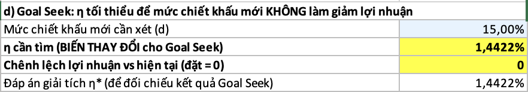

*Hình 15: Bài toán 2: Goal Seek, kết quả sau khi chạy (B51 trùng đáp án giải tích B53).*

### 3.5. Ý nghĩa quản lý

- Trong dữ liệu này chiết khấu không kéo thêm sản lượng nên mỗi điểm % chiết khấu thêm làm lợi nhuận giảm khoảng 51.800 USD trên toàn kỳ. Nên rà soát chương trình chiết khấu hiện hành thay vì mở rộng.
- Muốn tăng chiết khấu một cách có lợi, nhóm cần bằng chứng rằng cầu nhạy hơn mức 1,442% mỗi điểm %. Nên chạy thử A/B test ở một thị trường nhỏ trước.
- Hạn chế: η không ước lượng được từ dữ liệu nên các kịch bản có η dương chỉ là giả định; hệ số a và b rút từ 6 dải trung bình nên mô hình tuyến tính đơn giản; dữ liệu có giai đoạn cuối 2017 đổi cấu trúc đơn hàng nên số tuyệt đối chỉ mang tính tương đối.

## 4. Bài toán 3: Điểm hoà vốn theo ngành hàng

### 4.1. Mô tả

Mỗi ngành hàng gánh chi phí cố định (kho, nhân sự, marketing) bên cạnh biến phí. Câu hỏi là ngành nào đang bán sát điểm hoà vốn nên dễ lỗ khi sản lượng giảm.

### 4.2. Mô hình

| Thành phần | Nội dung |
|---|---|
| Biến quyết định | Sản lượng Q của ngành đang chọn (ô B9) |
| Biến kết quả | Lợi nhuận của ngành (ô B12), cần đưa về 0 để tìm điểm hoà vốn |
| Công thức | Lợi nhuận = p × Q − v × Q − F. p là giá thuần mỗi đơn vị; v là biến phí mỗi đơn vị bằng p trừ lợi nhuận mỗi đơn vị; F bằng 7% doanh thu thuần của ngành |
| Ràng buộc | 0 ≤ Q ≤ 1,5 × Q0, với Q0 là sản lượng hiện tại |

Công thức giải tích để đối chiếu: sản lượng hoà vốn = F chia (p − v). Biên an toàn = (Q0 − sản lượng hoà vốn) chia Q0.

### 4.3. Các bước thực hiện trong Excel

1. Mở sheet BT3_GoalSeek. Chọn ngành ở ô B3 từ danh sách thả xuống. Ngành mặc định là Fan Shop.
2. Gõ lại ô B9 bằng giá trị Q0 ở ô B6 để bắt đầu từ hiện trạng.
3. Chọn Data, What-If Analysis, Goal Seek. Set cell: B12. To value: 0. By changing cell: B9. Bấm OK.
4. So sánh B9 với B13 (hoà vốn giải tích); hai số phải trùng nhau. Nếu lệch thì mô hình có lỗi.
5. Chọn vùng A18:B24, mở Data, What-If Analysis, Data Table, Column input cell là B9 để tạo bảng lợi nhuận theo sản lượng (nếu Excel chưa tính sẵn).
6. Đổi ngành ở B3 và lặp lại các bước 2 đến 4 cho ít nhất hai ngành khác (nên chọn Book Shop và một ngành lớn) để so sánh.
7. Dùng bảng A28:H39 để xem toàn bộ 11 ngành cùng lúc.
8. Chạy độ nhạy theo chi phí cố định: chọn vùng A51:L56, mở Data, What-If Analysis, Data Table, Row input cell là B3, Column input cell là B7.

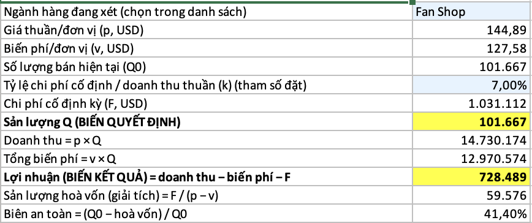

*Hình 16: Bài toán 3: Fan Shop trước khi chạy Goal Seek.*

*Hình 17: Bài toán 3: hộp thoại Goal Seek.*

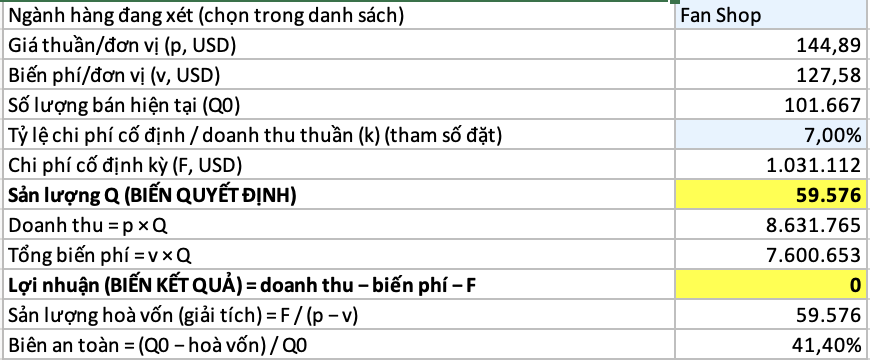

*Hình 18: Bài toán 3: Fan Shop sau khi chạy Goal Seek (sản lượng hoà vốn 59.576).*

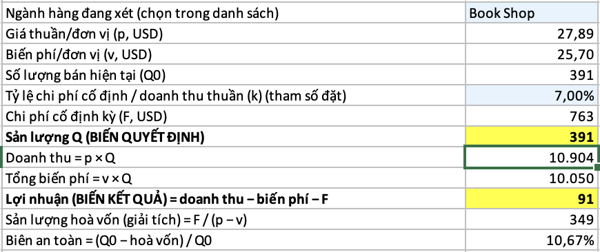

*Hình 19: Bài toán 3: Book Shop trước khi chạy Goal Seek.*

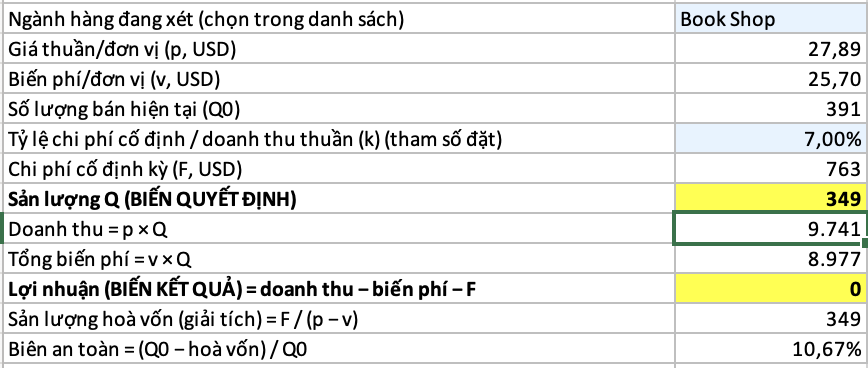

*Hình 20: Bài toán 3: Book Shop sau khi chạy Goal Seek (sản lượng hoà vốn 349).*

*Hình 21: Bài toán 3: hộp thoại Data Table lợi nhuận theo sản lượng.*

*Hình 22: Bài toán 3: hộp thoại Data Table độ nhạy theo chi phí cố định.*

### 4.4. Kết quả

Ví dụ Fan Shop: p bằng 144,89 USD, v bằng 127,58 USD, F bằng 1.031.112 USD, sản lượng hiện tại 101.667 đơn vị, sản lượng hoà vốn 59.576 đơn vị, biên an toàn 41,4%.

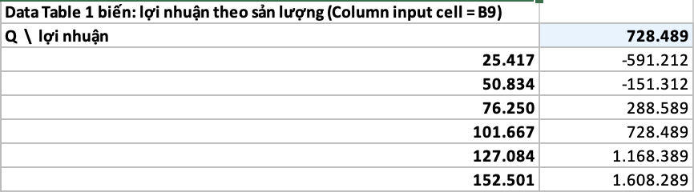

*Hình 23: Bài toán 3: lợi nhuận Fan Shop theo sản lượng.*

Biên an toàn của 11 ngành, xếp từ thấp lên cao:

| Ngành | Sản lượng hiện tại | Hoà vốn | Biên an toàn | Đánh giá |
|---|---|---|---|---|
| Book Shop | 391 | 349 | 10,7% | Rủi ro |
| Pet Shop | 472 | 338 | 28,4% | Theo dõi |
| Health and Beauty | 346 | 238 | 31,2% | Theo dõi |
| Footwear | 41.495 | 25.718 | 38,0% | Theo dõi |
| Fan Shop | 101.667 | 59.576 | 41,4% | An toàn |
| Golf | 94.975 | 55.299 | 41,8% | An toàn |
| Discs Shop | 1.943 | 1.109 | 42,9% | An toàn |
| Apparel | 93.981 | 53.366 | 43,2% | An toàn |
| Technology | 1.396 | 783 | 43,9% | An toàn |
| Outdoors | 24.945 | 13.327 | 46,6% | An toàn |
| Fitness | 5.980 | 3.164 | 47,1% | An toàn |

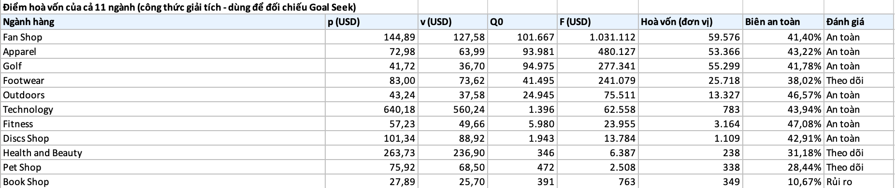

*Hình 24: Bài toán 3: điểm hoà vốn và biên an toàn của 11 ngành.*

Ngưỡng đánh giá (dưới 20% là Rủi ro, dưới 40% là Theo dõi) là quy ước của mô hình, không phải chuẩn ngành.

Độ nhạy theo tỷ lệ chi phí cố định k (biên an toàn của một số ngành):

| k | Fan Shop | Footwear | Health and Beauty | Pet Shop | Book Shop |
|---|---|---|---|---|---|
| 3% | 74,89% | 73,44% | 70,50% | 69,33% | 61,72% |
| 5% | 58,14% | 55,73% | 50,84% | 48,88% | 36,19% |
| 7% | 41,40% | 38,02% | 31,18% | 28,44% | 10,67% |
| 9% | 24,66% | 20,31% | 11,51% | 7,99% | −14,85% |
| 11% | 7,92% | 2,61% | −8,15% | −12,46% | −40,38% |

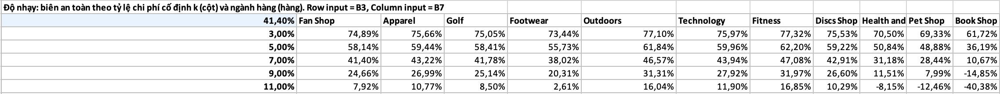

*Hình 25: Bài toán 3: biên an toàn theo tỷ lệ chi phí cố định k và ngành hàng.*

Thứ tự rủi ro không đổi theo k: Book Shop luôn thấp nhất, kế đó là Pet Shop và Health and Beauty. Khi k tăng đến 9%, Book Shop bắt đầu lỗ ngay ở sản lượng hiện tại; ở 11%, Health and Beauty và Pet Shop cũng lỗ.

### 4.5. Ý nghĩa quản lý

- Book Shop chỉ cách điểm hoà vốn 10,7%: sản lượng giảm hơn một phần mười là ngành bắt đầu lỗ. Nên cân nhắc giá, chiết khấu hoặc chi phí cố định của ngành này.
- Ba ngành quy mô nhỏ hoặc biên thấp (Pet Shop, Health and Beauty, Footwear) nên được theo dõi hằng tháng.
- Các ngành lớn như Fan Shop, Apparel, Golf có biên an toàn từ 41% đến 43%, tương đối vững.
- Hạn chế: chi phí cố định bằng 7% doanh thu thuần là tham số đặt. Kết luận về thứ tự rủi ro giữ nguyên khi k đổi từ 3% đến 11%, nhưng biên an toàn tuyệt đối thì đổi theo k. Biến phí rút từ lợi nhuận trung bình nên giả sử không đổi theo sản lượng.

## 5. Bài toán 4: Phân bổ đơn giữa 5 thị trường

### 5.1. Mô tả

Lợi nhuận mỗi đơn của Pacific Asia chỉ 49,02 USD, trong khi bốn thị trường còn lại từ 63,72 đến 65,94 USD. Doanh thu mỗi đơn của Pacific Asia cũng thấp hơn (471 USD so với 586 đến 599 USD). Câu hỏi là với cùng tổng số đơn, nên phân bổ nguồn lực lệch về thị trường nào.

### 5.2. Mô hình

| Thành phần | Nội dung |
|---|---|
| Biến quyết định | Số đơn phân bổ cho mỗi thị trường (ô G4:G8) |
| Biến kết quả | Tổng lợi nhuận (ô H9), cần tối đa |
| Công thức | Lợi nhuận thị trường i = lợi nhuận mỗi đơn của i × số đơn phân bổ. Tổng lợi nhuận = tổng các thị trường |
| Ràng buộc | Tổng số đơn giữ nguyên 62.897. Mỗi thị trường từ 80% đến 120% số đơn hiện tại |

Dữ liệu đầu vào:

| Thị trường | Đơn hiện tại | Lợi nhuận mỗi đơn (USD) |
|---|---|---|
| Europe | 17.763 | 63,72 |
| Pacific Asia | 16.853 | 49,02 |
| LATAM | 16.414 | 65,13 |
| USCA | 8.178 | 65,94 |
| Africa | 3.689 | 65,07 |

### 5.3. Các bước thực hiện trong Excel

1. Mở sheet BT4_Solver. Các ô G4:G8 là biến quyết định, đang chứa số đơn hiện tại.
2. Kiểm tra: H4:H8 là lợi nhuận từng thị trường, H9 là tổng, E và F là cận dưới và cận trên.
3. Chọn Data, rồi Solver. Set Objective: H9, chọn Max. By Changing Variable Cells: G4:G8.
4. Bấm Add, thêm ba ràng buộc theo bảng A22:D25: G4:G8 lớn hơn hoặc bằng E4:E8; G4:G8 nhỏ hơn hoặc bằng F4:F8; G9 bằng B12.
5. Tick Make Unconstrained Variables Non-Negative, chọn Simplex LP, bấm Solve, rồi Keep Solver Solution.
6. Đối chiếu kết quả với bảng kiểm chứng ở A28:B35; hai bên phải trùng nhau (có thể lệch dưới 1 đơn do làm tròn).

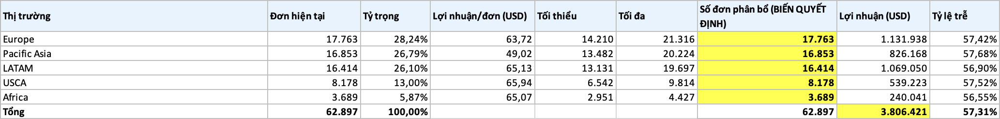

*Hình 26: Bài toán 4: bảng mô hình trước khi chạy Solver.*

*Hình 27: Bài toán 4: hộp thoại Solver Parameters.*

### 5.4. Kết quả

| Thị trường | Đơn hiện tại | Đơn tối ưu | Thay đổi |
|---|---|---|---|
| Europe | 17.763 | 15.477 | −13% |
| Pacific Asia | 16.853 | 13.482 | −20% |
| LATAM | 16.414 | 19.697 | +20% |
| USCA | 8.178 | 9.814 | +20% |
| Africa | 3.689 | 4.427 | +20% |

Tổng lợi nhuận tăng từ 3.806.421 USD lên 3.865.201 USD, tức tăng 58.781 USD (1,5%). Ba thị trường lợi nhuận cao nhất (USCA, Africa, LATAM) đều chạm cận trên 120%; Pacific Asia chạm cận dưới 80%; Europe nhận phần còn lại.

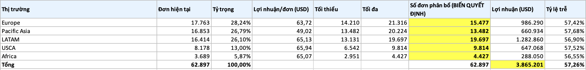

*Hình 28: Bài toán 4: kết quả sau khi chạy Solver.*

### 5.5. Ý nghĩa quản lý

- Nên ưu tiên mở rộng nguồn lực ở USCA, LATAM, Africa và giảm đầu tư ở Pacific Asia, nơi mỗi đơn lãi kém hơn khoảng 25%.
- Trước khi dịch chuyển, cần tìm nguyên nhân vì sao Pacific Asia thấp: nếu do cơ cấu sản phẩm (giá bán thấp) thì cải thiện cơ cấu có thể hiệu quả hơn là cắt giảm.
- Hạn chế: lợi nhuận mỗi đơn của thị trường được giữ nguyên khi số đơn đổi, trong khi thực tế nó phụ thuộc cơ cấu sản phẩm và có thể giảm khi mở rộng nhanh; biên ±20% là tham số đặt; tỷ lệ trễ gần như bằng nhau giữa các thị trường (56,5% đến 57,7%) nên không đóng vai trò trong bài toán này.

## 6. Kết luận và hướng phát triển

Bốn mô hình đều chạy trên số liệu thật của Phần A và cho kết luận định lượng:

- Đưa tỷ lệ trễ từ 57,3% về 45% bằng cách chuyển đơn sang Standard Class và Same Day chỉ làm mất 41.998 USD lợi nhuận (1,1%); nếu mỗi đơn trễ tốn từ 20 USD trở lên thì việc này có lãi.
- Chiết khấu hiện không kéo sản lượng nên mỗi điểm % chiết khấu thêm làm mất khoảng 51.800 USD.
- Book Shop là ngành sát hoà vốn nhất ở mọi mức chi phí cố định từ 3% đến 11%.
- Dồn đơn từ Pacific Asia sang ba thị trường lợi nhuận cao hơn tăng khoảng 1,5% lợi nhuận.

Hạn chế chung là các tham số do người ra quyết định đặt ở mục 1.1 và việc dữ liệu giao hàng có dạng mô phỏng. Hướng phát triển: thay tham số đặt bằng số thật (chi phí phạt trễ, chi phí cố định, năng lực kho), ước lượng độ co giãn cầu bằng thí nghiệm giảm giá, và gộp bốn bài toán thành một mô hình tối ưu đa mục tiêu.
